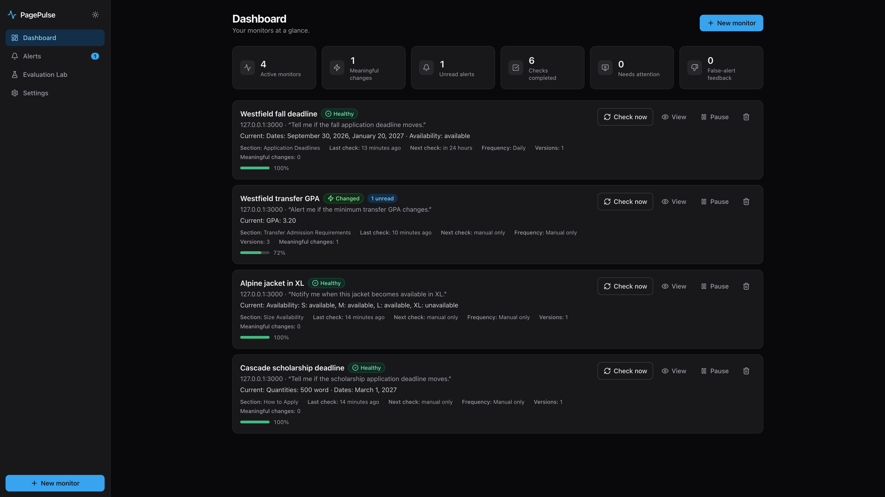
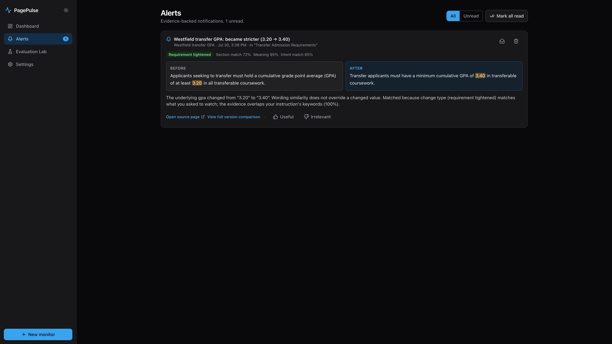
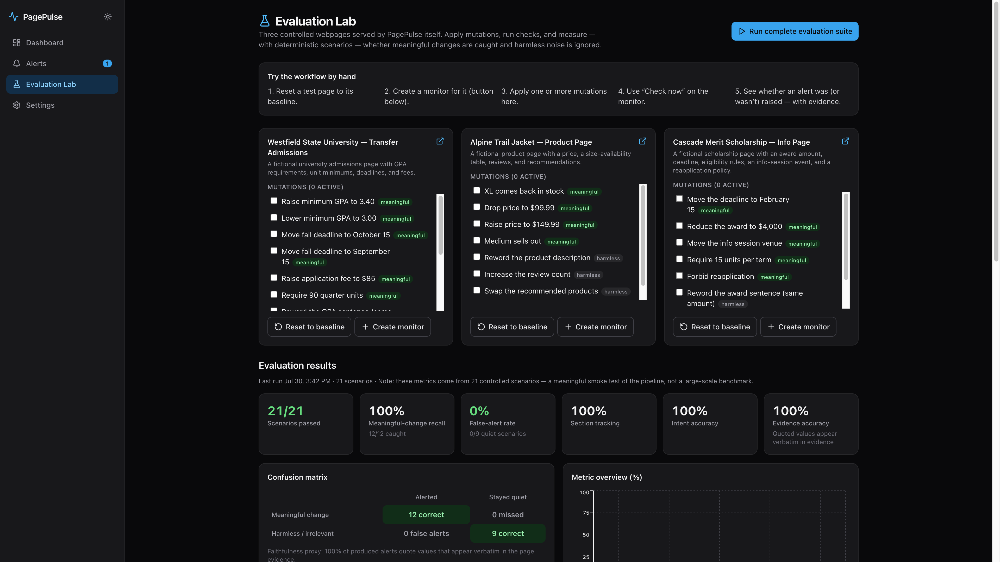

# PagePulse

PagePulse is an evidence-first monitoring platform that tracks meaningful changes on public webpages. Users describe what information matters, and PagePulse filters out harmless webpage noise while showing the exact evidence behind relevant alerts.

## Overview

You provide a public URL and a natural-language instruction such as *“Alert me if the minimum transfer GPA changes.”* PagePulse saves a clean baseline of the relevant page section, re-checks it on a schedule or on demand, distinguishes factual changes from cosmetic noise, and alerts **only** when a change matches your monitoring intent. Every alert shows old and new values with verbatim page evidence.

This is a polished single-user portfolio application. It runs fully locally with no paid APIs, external database, or Redis.

## Problem

Important information lives on public pages that change silently: admission requirements, scholarship deadlines, event locations, return policies, product prices, and stock. Generic page-diff tools treat every edit as equal — a reworded sentence, a new footer year, or a shuffled navigation bar all look like “changes.” PagePulse’s contract is stricter: **an alert must mean the underlying information changed, and it must show the proof.**

## How It Works

1. Enter a public URL and describe what matters in plain English.
2. PagePulse fetches the page server-side, cleans the content, and shows readable sections.
3. You confirm (or override) the ranked section that should be monitored.
4. A baseline snapshot is saved with extracted facts (GPA, dates, prices, availability, and more).
5. Later checks re-find the section, detect structured differences, judge whether the change is meaningful, filter by intent, and create evidence-backed alerts when appropriate.

## Key Features

- Natural-language monitoring instructions with an editable structured interpretation
- User-confirmed webpage sections — nothing is chosen silently
- Server-side webpage fetching with SSRF protections
- Webpage content cleaning (scripts, nav, ads, cookie banners, boilerplate)
- Section matching across renames, moves, and nearby context changes
- Structured fact extraction: dates, prices, percentages, GPA, availability, quantities, contacts
- Meaningful versus cosmetic change detection (values override superficial wording similarity)
- Intent filtering by field, variant, trigger direction, and keywords
- Confidence scores and honest *Blocked* / *Uncertain* / *Failed* states
- Old-versus-new evidence with highlighted changed values
- Version history and any-two-snapshot comparison
- In-app alerts with useful / irrelevant feedback (per-monitor threshold adjustment only)
- Scheduled and manual checks with per-domain rate limiting and retries
- Controlled Evaluation Lab with deterministic scenarios and detection metrics
- Dark and light themes, responsive layout, accessible dialogs and controls

## Monitor Creation Workflow

1. **URL & intent** — public page URL, monitor name, and instruction.
2. **Fetch & inspect** — title, final URL, fetch status, cleaned section preview.
3. **Section selection** — top candidate sections ranked with confidence; manual override allowed.
4. **Baseline confirmation** — selected content, detected category, extracted values, editable intent fields.
5. **Save** — choose frequency (15 min / hourly / 6 hours / daily / manual only) and store the baseline snapshot.

## Meaningful Change Detection

PagePulse does not rely on a giant raw text diff. It pairs sentences, extracts typed facts, and categorizes changes such as value increase/decrease, date moved earlier/later, became available/unavailable, requirement tightened/relaxed, location changed, and general text change.

A local `SemanticComparisonProvider` decides meaning:

- Structured value changes override high sentence similarity.
- Negation flips are treated as meaningful.
- Equivalent rewording with the same extracted values is not meaningful.
- Promotional / boilerplate additions are ignored.

This is honest structured and semantic analysis — not a hosted language model. An interface exists so an LLM provider can be plugged in later.

## Intent Filtering

Instructions are parsed into subject, field, optional variant (for example `XL`), trigger, and keywords. Changes are scored against that structure so an XL-availability intent does not fire for Medium, and a GPA intent does not fire for an application-fee change. Marking an alert *irrelevant* raises only that monitor’s relevance threshold.

## Evidence-Backed Alerts

Alerts are created only when the section match is confident, the change is meaningful, and intent matches. Each alert includes:

- plain-language title and summary
- category, old/new values, old/new evidence
- section heading and detection time
- section-match, meaning, and intent-match confidence
- explanation of why it matched

## Version History

Each successful check can produce a snapshot with retrieval time, section text, extracted facts, content hash, and fetch status. Any two versions can be compared with annotated changes and evidence.

## Evaluation Lab

PagePulse serves controlled fictional test pages (college admissions, product availability/pricing, scholarship/event/policy, plus a Transfer GPA workflow fixture). Each page supports named meaningful and harmless mutations. A one-click evaluation suite runs deterministic scenarios through the real pipeline and reports:

- meaningful-change recall
- false-alert rate
- section-tracking accuracy
- intent-match accuracy
- evidence accuracy / faithfulness proxy
- confusion-matrix style outcomes

These metrics come from a small controlled scenario set — a rigorous smoke test, not a large-scale benchmark.

## Screenshots

| Dashboard | Alert with evidence | Evaluation Lab |
| --- | --- | --- |
|  |  |  |

## Architecture

```
PagePulse/
├── client/                 # React + Vite + Tailwind frontend
│   └── src/
│       ├── pages/          # Landing, Dashboard, Create, Detail, Compare, Alerts, Lab, Settings
│       ├── components/     # Shared UI
│       └── lib/            # API client, types, formatting
├── server/                 # Express + TypeScript backend
│   ├── src/
│   │   ├── lib/            # fetcher, cleaner, extract, intent, sectionMatch, diff, meaning, checkRunner
│   │   ├── lab/            # Controlled pages, scenarios, eval runner
│   │   ├── routes/         # REST API
│   │   ├── scripts/        # db:init, db:seed
│   │   └── scheduler.ts    # node-cron due-monitor loop
│   └── test/               # Vitest unit + integration tests
├── docs/screenshots/       # README screenshots
├── data/                   # Local SQLite (git-ignored)
├── Dockerfile              # Optional container image
├── .env.example
└── package.json            # npm workspaces root
```

Check pipeline:

```
fetcher → cleaner → sectionMatch → diffEngine → meaning → intent → notify
```

In production, Express serves the built client from `client/dist`.

## Technology Stack

| Layer | Stack |
| --- | --- |
| Frontend | React 18, TypeScript, Vite, Tailwind CSS, React Router, Lucide, Recharts |
| Backend | Node.js, Express, TypeScript, better-sqlite3, Zod, Cheerio, Mozilla Readability + JSDOM, node-cron, Nodemailer (optional) |
| Testing | Vitest, Supertest |
| Packaging | npm workspaces |

## Secure Webpage Fetching

- Accepts only `http:` / `https:` URLs; rejects credentials embedded in URLs
- Blocks localhost, private, link-local, and internal destinations after DNS resolution
- Re-validates every redirect hop (limited redirect count)
- Timeouts, response size caps, and content-type filtering
- Clear user agent; no cookies; page scripts are not executed
- Lab pages on the app’s own origin are the only sanctioned loopback exception

## Local Development

Requires **Node.js 20+**. No Docker, external database, Redis, or API key is required.

```bash
npm install          # installs client + server workspaces from the lockfile
npm run db:init      # create a clean SQLite database under ./data
npm run db:seed      # reset Evaluation Lab pages to baseline (optional)
npm run dev          # API on :3000, Vite client on :5173
```

Useful scripts:

| Command | Purpose |
| --- | --- |
| `npm run dev` | Full-stack development (server + client) |
| `npm run dev:server` | Backend only (`tsx watch`) |
| `npm run dev:client` | Frontend only (Vite) |
| `npm run typecheck` | TypeScript checks for both packages |
| `npm test` | Unit + integration tests |
| `npm run test:eval` | Deterministic evaluation suite only |
| `npm run db:init` / `npm run db:seed` | Database initialize / lab baseline reset |
| `npm run build` / `npm start` | Production build and start |

Open http://localhost:5173 in development, or http://localhost:3000 after a production build.

On the dashboard, **Load sample monitors** creates demo monitors against the built-in lab pages (all fictional content).

## Environment Variables

See [`.env.example`](.env.example). Every variable is optional for core use.

| Variable | Purpose | Default |
| --- | --- | --- |
| `PORT` | Server listen port | `3000` |
| `DATA_DIR` | SQLite directory | `./data` |
| `PAGEPULSE_DB` | Override DB path (tests use `:memory:`) | unset |
| `PAGEPULSE_DISABLE_SCHEDULER` | Disable cron when set to `1` | unset |
| `SMTP_*` / `NOTIFY_EMAIL_TO` | Optional email delivery | disabled |

If SMTP is not configured, in-app alerts still work and Settings states that email is disabled.

## Database Setup

SQLite is created automatically by `npm run db:init`. Schema lives in `server/src/db.ts`. Seed/reset scripts restore lab page baselines; they do not ship real user data. Local `*.db` files are git-ignored.

## Testing

```bash
npm test            # all server unit + integration tests
npm run test:eval   # evaluation suite scenarios
```

Tests use an in-memory database and locally served lab pages — **no public internet**. Coverage includes URL/SSRF guards, cleaning, extraction, section matching, meaning comparison, intent filtering, monitor lifecycle, and the full evaluation suite.

## Production Build

```bash
npm run build
npm start
```

The production server serves the API and the built frontend from one process.

## Deployment Considerations

Use a persistent Node host (for example Render, Railway, Fly.io, or a VPS):

1. `npm ci && npm run build`
2. Run `node server/dist/index.js` under a process manager
3. Persist `DATA_DIR` so SQLite survives restarts
4. Optionally configure SMTP

**Scheduled monitoring requires the Node process to stay running.** GitHub Pages cannot host this full-stack application. Serverless request/response platforms are a poor fit for the scheduler. An optional `Dockerfile` is included for container hosts.

## Known Limitations

- Best for public, mostly server-rendered HTML pages
- Does not bypass logins, CAPTCHAs, paywalls, or anti-bot systems
- JavaScript-heavy SPAs often yield few readable sections (reported honestly)
- Meaning analysis is local and rule-based; subtle prose-only shifts without extractable values can be ambiguous
- Single-user: no accounts, teams, payments, SMS, or browser extension

## Future Improvements

- Hosted LLM comparison behind the existing provider interface
- Optional headless-browser fetching for JS-rendered pages
- Snapshot retention policies
- Webhook / RSS notification channels
- Larger third-party evaluation corpora

## Author

**Manpreet Singh**  
Computer Science Student at De Anza College

Designed and developed as a portfolio project exploring full-stack development, secure webpage extraction, semantic change analysis, background scheduling, evidence-grounded explanations, and measurable software evaluation.

## License

[MIT](LICENSE) © 2026 Manpreet Singh
